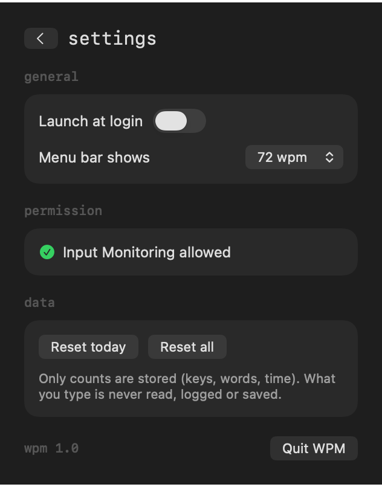

# WPM for macOS

A macOS port of [TheUthaGuy/wordsPerMinute](https://github.com/TheUthaGuy/wordsPerMinute),
a Windows typing-speed tracker written in Rust. Credit for the original idea and its
counting model goes to TheUthaGuy. This port is a native rewrite in Swift.

It shows your live words per minute from typing in any app, right in the menu bar.

## Screenshots

| Menu bar | Popover | Settings | Onboarding |
| --- | --- | --- | --- |
|  |  |  |  |

Light and dark versions of every screen, plus the popover before permission is
granted, are in [`screenshots/`](screenshots). They were rendered by the app
itself (`--render-snapshots`), with demo data (`--demo`). The macOS 15 tile style
is shown, because Liquid Glass can't be drawn offscreen. The menu bar strip
around the label is drawn by the renderer.

## Features

- **SwiftUI `MenuBarExtra`** (window style), `LSUIElement` agent with no Dock icon.
- **Same counting model as the original:** keys are classified as *character*,
  *separator* (space/return/tab) or *backspace*. WPM is the standard 5 typed
  characters per word, measured over a rolling 10 s window. Sessions end after 60 s
  idle. Average WPM only counts active typing time (gaps over 5 s are excluded).
  Peak is only tracked once the window is full.
- **Popover:** live WPM, a 5‑minute Swift Charts sparkline, and today's avg, peak,
  accuracy (1 − backspaces/keystrokes), words, keystrokes, session time and
  typing time.
- **Settings:** launch at login (`SMAppService`), menu bar format, permission
  status, reset today/all, quit.
- **macOS 26+:** Liquid Glass tiles (`glassEffect` in a `GlassEffectContainer`) and
  `.glass` button styles. **macOS 15:** quiet filled tiles and bordered buttons.
- **Privacy:** a *listen‑only* `CGEventTap` reads only the key code, modifier flags
  and auto‑repeat flag, then discards the event. Characters are never decoded.
  Only daily counts are saved, to `~/Library/Application Support/WPMBar/days.json`.
  It needs **Input Monitoring** only, not Accessibility.

## Build, run, test

Requires Xcode or the Command Line Tools with the macOS 26 SDK. The deployment
target is macOS 15.

```sh
./scripts/test.sh          # unit tests (Swift Testing)
./scripts/build-app.sh     # -> build/WPM.app (ad-hoc signed)
open build/WPM.app
```

On first launch an onboarding window explains the permission. **Open System
Settings** registers the app and opens Privacy & Security → Input Monitoring.
Once you switch WPM on, the app starts counting within a second. If macOS insists,
use the Relaunch button.

Developer flags:

| flag | what it does |
| --- | --- |
| `--demo` | Synthetic typing (~85 wpm) through the real engine. Uses a temp store, so real stats are untouched |
| `--onboarding` | Always show the onboarding window |
| `--render-snapshots DIR` | Render every screen offscreen (light and dark) to PNG, then exit |
| `--debug-hooks` | Accept `local.wpmbar.debug` distributed notifications (`settings`, `stats`, `onboarding`, `close-onboarding`). Used by `scripts/screenshots.sh` |

`scripts/screenshots.sh [--demo]` takes real `screencapture` shots into
`~/Desktop/wpm-screenshots`. It needs an unlocked screen and Screen Recording
permission for your terminal, and asks you to click the menu bar item once.

## Layout

```
Sources/WPMCore/   KeyClassifier, WPMEngine (rolling window, sessions, idle, day roll‑over), DayStats, StatsStore
Sources/WPMBar/    App + AppDelegate, AppModel, KeyMonitor (CGEventTap), PopoverView, SettingsView, OnboardingView, Style
Tests/WPMCoreTests Swift Testing suites: classification, word detection, rolling window, idle handling, daily stats, formatting
Support/Info.plist LSUIElement, bundle id local.wpmbar.WPMBar, min macOS 15
```

## Not ported from the original

The original's floating overlay, theme editor, global hotkeys, session history
dashboard and CSV/JSON export are not ported. The menu bar item and popover take
the overlay's place.

## Licence

The original [wordsPerMinute](https://github.com/TheUthaGuy/wordsPerMinute) repository
has no licence file, so it is all rights reserved by its author. This port doesn't
add a licence of its own. Ask the original author before redistributing it.
