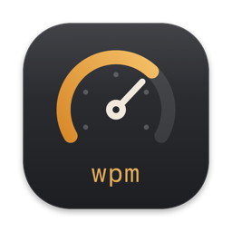
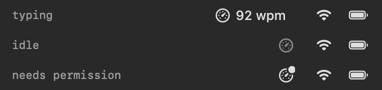
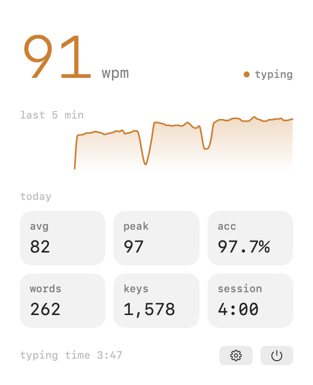
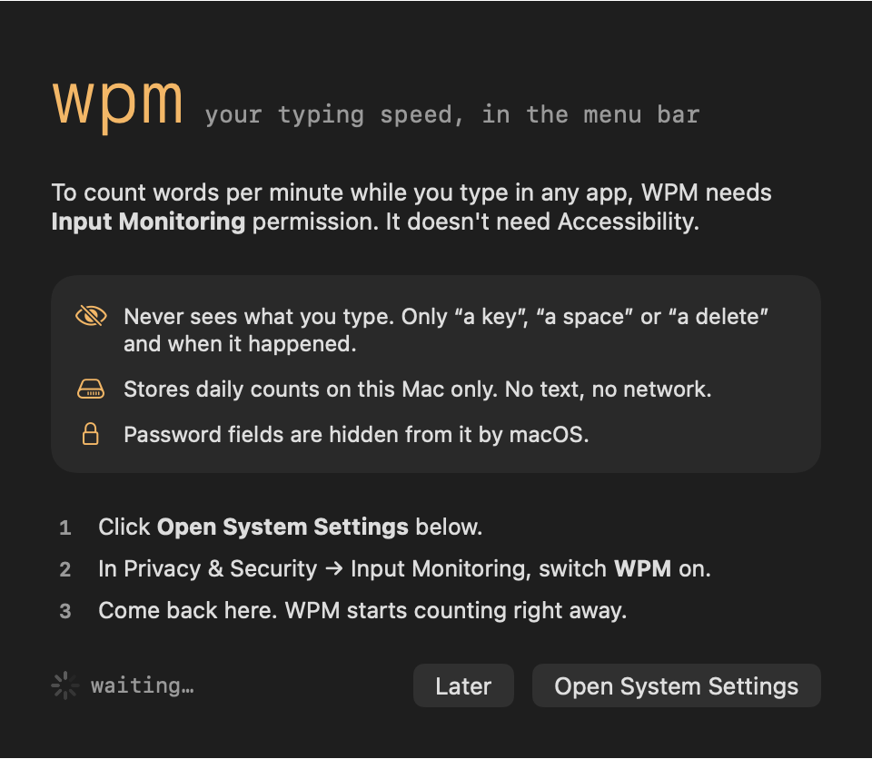

# WPM for macOS



A macOS port of [TheUthaGuy/wordsPerMinute](https://github.com/TheUthaGuy/wordsPerMinute),
a Windows typing-speed tracker written in Rust. Credit for the original idea and its
counting model goes to TheUthaGuy. This port is a native rewrite in Swift.

It shows your live words per minute from typing in any app, right in the menu bar.

## Screenshots

| Menu bar | Popover | Settings | Onboarding |
| --- | --- | --- | --- |
|  |  |  |  |

Light and dark versions of every screen, plus the popover before permission is
granted, are in [`screenshots/`](screenshots). They were rendered by the app
itself (`--render-snapshots`), with demo data (`--demo`). The macOS 15 tile style
is shown, because Liquid Glass can't be drawn offscreen. The menu bar strip
around the label is drawn by the renderer.

## Install

Needs macOS 15 or later. Runs on Apple Silicon and Intel (universal build).

### One-line install

While this repo is **private**, use the GitHub CLI. It needs `gh` installed and signed in
to an account with access (`brew install gh && gh auth login`):

```sh
gh api repos/j4ckxyz/wordsPerMinute-macos/contents/install.sh -H "Accept: application/vnd.github.raw" | bash
```

Once the repo is **public**, plain curl works:

```sh
curl -fsSL https://raw.githubusercontent.com/j4ckxyz/wordsPerMinute-macos/main/install.sh | bash
```

`install.sh` downloads the latest release zip (with `gh` when it's signed in,
otherwise with curl). It checks the SHA-256 checksum and installs `WPM.app` to
`/Applications`, or to `~/Applications` if `/Applications` isn't writable. Then
it clears the quarantine flag and opens the app. Pin a version with
`| bash -s -- --version v0.1.0`.

### DMG

1. Download `WPM-<version>.dmg` from [Releases](https://github.com/j4ckxyz/wordsPerMinute-macos/releases)
   (`gh release download --repo j4ckxyz/wordsPerMinute-macos --pattern '*.dmg'` while private).
2. Open it and drag **WPM** onto **Applications**.
3. WPM is ad-hoc signed, not notarised (there's no Developer ID), so the first
   launch is blocked by Gatekeeper. Either:
   - right-click (Control-click) **WPM** in Applications → **Open** → **Open**, or
   - try to open it once, then go to **System Settings → Privacy & Security** and
     click **Open Anyway** next to "WPM was blocked…".

   Or clear the quarantine flag from Terminal: `xattr -dr com.apple.quarantine /Applications/WPM.app`.
4. Allow **Input Monitoring** when the onboarding window asks.

### Uninstall

```sh
# remove the app, keep your stats
gh api repos/j4ckxyz/wordsPerMinute-macos/contents/install.sh -H "Accept: application/vnd.github.raw" | bash -s -- --uninstall
# remove the app, stats, settings and the Input Monitoring entry
gh api repos/j4ckxyz/wordsPerMinute-macos/contents/install.sh -H "Accept: application/vnd.github.raw" | bash -s -- --purge
```

(Swap in the `curl … | bash -s -- --uninstall` form once the repo is public.) Or by hand:
quit WPM from its popover, delete `WPM.app` from Applications. Optionally delete
`~/Library/Application Support/WPMBar` and run
`tccutil reset ListenEvent local.wpmbar.WPMBar`. If you turned on launch at login,
turn it off in Settings before deleting the app, or remove it under System
Settings → General → Login Items.

## Features

- **SwiftUI `MenuBarExtra`** (window style), `LSUIElement` agent with no Dock icon.
- **Menu bar item:** a template gauge glyph that adapts to light, dark and tinted menu
  bars. It shows the number while you type (`92 wpm`), is dimmed when idle, and gets
  a badge dot while Input Monitoring isn't granted. Choose "icon + 72 wpm",
  "icon + 72" or "icon only" in Settings.
- **Same counting model as the original:** keys are classified as *character*,
  *separator* (space/return/tab) or *backspace*. WPM is the standard 5 typed
  characters per word, measured over a rolling 10 s window. Sessions end after 60 s
  idle. Average WPM only counts active typing time (gaps over 5 s are excluded).
  Peak is only tracked once the window is full.
- **Popover:** live WPM, a 5‑minute Swift Charts sparkline, and today's avg, peak,
  accuracy (1 − backspaces/keystrokes), words, keystrokes, session time and
  typing time.
- **Settings:** launch at login (`SMAppService`), menu bar format, permission
  status, reset today/all, quit.
- **macOS 26+:** Liquid Glass tiles (`glassEffect` in a `GlassEffectContainer`) and
  `.glass` button styles. **macOS 15:** quiet filled tiles and bordered buttons.
- **Privacy:** a *listen‑only* `CGEventTap` reads only the key code, modifier flags
  and auto‑repeat flag, then discards the event. Characters are never decoded.
  Only daily counts are saved, to `~/Library/Application Support/WPMBar/days.json`.
  It needs **Input Monitoring** only, not Accessibility.

## Build, run, test

Requires Xcode or the Command Line Tools with the macOS 26 SDK. The deployment
target is macOS 15.

```sh
./scripts/test.sh          # unit tests (Swift Testing)
./scripts/build-app.sh     # -> build/WPM.app (universal, ad-hoc signed, version from VERSION)
open build/WPM.app
./scripts/make-dmg.sh      # -> dist/WPM-<version>.dmg, dist/WPM-<version>.zip, dist/SHA256SUMS.txt
```

The app icon is generated in code: `swift scripts/make-icon.swift Support/AppIcon.icns`.

To cut a release: bump `VERSION`, run `./scripts/make-dmg.sh`, then
`gh release create v$(cat VERSION) dist/*`.

On first launch an onboarding window explains the permission. **Open System
Settings** registers the app and opens Privacy & Security → Input Monitoring.
Once you switch WPM on, the app starts counting within a second. If macOS insists,
use the Relaunch button.

Developer flags:

| flag | what it does |
| --- | --- |
| `--demo` | Synthetic typing (~85 wpm) through the real engine. Uses a temp store, so real stats are untouched |
| `--onboarding` | Always show the onboarding window |
| `--render-snapshots DIR` | Render every screen offscreen (light and dark) to PNG, then exit |
| `--debug-hooks` | Accept `local.wpmbar.debug` distributed notifications (`settings`, `stats`, `onboarding`, `close-onboarding`). Used by `scripts/screenshots.sh` |

`scripts/screenshots.sh [--demo]` takes real `screencapture` shots into
`~/Desktop/wpm-screenshots`. It needs an unlocked screen and Screen Recording
permission for your terminal, and asks you to click the menu bar item once.

## Layout

```
Sources/WPMCore/   KeyClassifier, WPMEngine (rolling window, sessions, idle, day roll‑over), DayStats, StatsStore
Sources/WPMBar/    App + AppDelegate, AppModel, KeyMonitor (CGEventTap), PopoverView, SettingsView, OnboardingView, Style
Tests/WPMCoreTests Swift Testing suites: classification, word detection, rolling window, idle handling, daily stats, formatting
Support/Info.plist LSUIElement, bundle id local.wpmbar.WPMBar, min macOS 15
```

## Not ported from the original

The original's floating overlay, theme editor, global hotkeys, session history
dashboard and CSV/JSON export are not ported. The menu bar item and popover take
the overlay's place.

## Licence

The original [wordsPerMinute](https://github.com/TheUthaGuy/wordsPerMinute) repository
has no licence file, so it is all rights reserved by its author. This port doesn't
add a licence of its own. Ask the original author before redistributing it.
